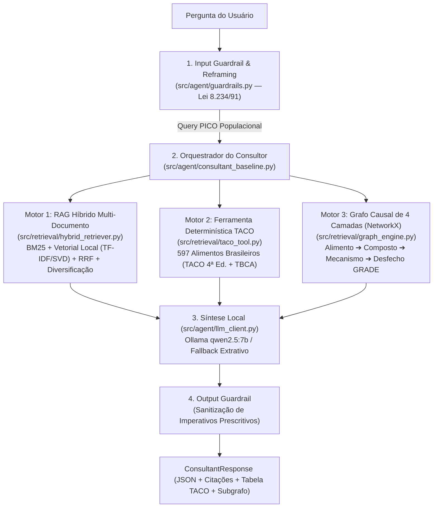

# Contexto Geral do Projeto — Consultor Científico de Nutrição Baseado em Evidências

**Diretório do Projeto:** `/Users/aluno2/Documents/Residencia/projeto_2`
**Ambiente Python:** Python 3.12 gerenciado via `uv` (`.venv` local) + Modelo Local no **Ollama (`qwen2.5:7b` / `qwen2.5:3b`)**.

---

## 1. Objetivo e Regra de Conformidade Legal (Lei nº 8.234/1991)

O sistema atua como um **Consultor Científico de Nutrição Baseado em Evidências**, traduzindo diretrizes oficiais, meta-análises e tabelas nutricionais para responder dúvidas gerais de alimentação, metabolismo, suplementos e compostos bioativos.

* **Trava Legal (Lei Federal nº 8.234/1991, Art. 3º - CFN):**
  * **Proibido (Privativo do Nutricionista):** Prescrição dietética individualizada (cardápios com calorias, gramaturas e horários para um indivíduo), diagnóstico nutricional clínico a partir de exames e prescrição posológica personalizada de suplementos.
  * **Permitido e Implementado:** Educação alimentar e nutricional (EAN), explicação de mecanismos fisiológicos causais, apresentação de faixas estudadas em protocolos científicos populacionais, classificação de nível de evidência (`GRADE`) e consulta determinística de composição de alimentos por 100g.

---

## 2. Arquitetura Implementada (Tríade: RAG Híbrido + Tabela TACO + Grafo Causal de 4 Camadas)



---

## 3. Bases de Dados Reais Integradas (`data/raw/`)

1. **Guia Alimentar para a População Brasileira (2ª Edição Oficial — Ministério da Saúde):**
   * **PDF Original:** `data/raw/pdfs/guia_alimentar_populacao_brasileira_2ed.pdf` (158 páginas, 4,2 MB).
   * **JSON Extraído:** `data/raw/guidelines/guia_alimentar_ms_2ed.json` (8 capítulos oficiais, 120 seções paginadas, **214.794 caracteres** extraídos via `src/ingestion/pdf_ingestor.py`).
2. **Meta-Análises e Revisões Sistemáticas Reais do PubMed (API NCBI Entrez):**
   * **JSON Extraído:** `data/raw/guidelines/pubmed_clinical_evidence.json` (**34 artigos reais** com `PMID`, `DOI`, periódico e resumos completos em 6 domínios clínicos, **79.221 caracteres**, coletados via `src/ingestion/pubmed_ingestor.py`).
3. **Sínteses Normativas de Diretrizes Clínicas (SBD, SBC, ISSN, IOC):**
   * **Arquivo:** `data/raw/guidelines/seed_guidelines.json` (10 documentos cobrindo diretrizes de diabetes, dislipidemias, hipertensão/DASH, proteínas/sarcopenia, suplementos Grau A, fitoquímicos e micronutrientes).
4. **Tabela Brasileira de Composição de Alimentos (TACO 4ª Edição — Unicamp + TBCA-USP):**
   * **Arquivo:** `data/raw/taco/taco_raw.json` (**597 alimentos brasileiros** com macronutrientes, fibras, 10 minerais, vitaminas, ácidos graxos mono/poli-insaturados e aminoácidos essenciais como leucina, lisina e metionina por 100g).
5. **Grafo de Conhecimento Controlado de 4 Camadas (PICO / GRADE):**
   * **Arquivo:** `data/raw/knowledge_graph/nutrition_4layer_graph.json` (14 cadeias causais completas modeladas em `NetworkX`: `FOOD ➔ COMPOUND ➔ MECHANISM ➔ OUTCOME`, incluindo diferenciação entre sinergia clínica `Curcumina + Piperina` vs. baixa biodisponibilidade isolada, e alertas de contraindicação como potássio elevado na Doença Renal Crônica).

---

## 4. Mapa de Arquivos do Repositório

* `pyproject.toml`: Configuração de pacotes (`uv`) e `pytest`.
* `src/config.py`: Caminhos e hiperparâmetros (`TOP_K_BM25=8`, `TOP_K_VECTOR=8`, `MAX_CHUNKS_PER_DOC=2`, `OLLAMA_MODEL=qwen2.5:7b`).
* `src/models/schemas.py`: Contratos `Pydantic` (`DocumentChunk`, `RetrievedChunk`, `TacoFoodNutrientRecord`, `CausalGraphPath`, `GuardrailAssessment`, `ConsultantResponse`).
* `src/ingestion/pdf_ingestor.py`: Extrator do PDF de 158 páginas do Guia Alimentar.
* `src/ingestion/pubmed_ingestor.py`: Coletor de meta-análises reais na API `eutils.ncbi.nlm.nih.gov`.
* `src/ingestion/contextual_chunker.py`: Fatiador que injeta cabeçalhos contextuais e carrega todos os JSONs de `data/raw/guidelines/` (> 230 chunks).
* `src/retrieval/hybrid_retriever.py`: Busca Léxica (`BM25Okapi`) + Busca Vetorial Local (`TF-IDF + TruncatedSVD/LSA`) + Fusão `RRF` + Reranker GRADE + Diversificação por documento.
* `src/retrieval/taco_tool.py`: Consulta exata e ranking de nutrientes sobre os 597 alimentos da Tabela TACO.
* `src/retrieval/graph_engine.py`: Motor de travessia em grafo de 4 camadas (`networkx.MultiDiGraph`) com detecção de contraindicações.
* `src/agent/guardrails.py`: Guardrail de entrada (classificação e *Reframing* para a Lei 8.234/91) e sanitizador de saída.
* `src/agent/llm_client.py`: Cliente para o Ollama local (`qwen2.5:7b` / `qwen2.5:3b`) com fallback extrativo determinístico.
* `src/agent/consultant_baseline.py`: Orquestrador central integrando Guardrail + RAG Híbrido + TACO + Grafo 4 Camadas + LLM.
* `src/api.py`: CLI interativo e servidor FastAPI (`GET /health`, `POST /consult`).
* `src/evaluation/run_benchmark.py`: Executor do benchmark de 12 questões (`data/benchmark/eval_questions.json`) e do Estudo de Ablação (`--ablation`).
* `tests/`: 20 testes automatizados (`test_guardrails.py`, `test_hybrid_retriever.py`, `test_taco_tool.py`, `test_graph_engine.py`, `test_consultant_baseline.py`).

---

## 5. Resultados Obtidos nos Testes e no Estudo de Ablação

* **Testes Automatizados (`pytest`):** `20 passed in 1.66s` (100% de aprovação).
* **Estudo de Ablação (`--ablation`):**

| Estágio da Arquitetura | Recall@4 (Docs) | Cobertura Geral de Termos | Questões Multi-Hop / TACO / Grafo | Acurácia Guardrail (Lei 8.234/91) |
| :--- | :---: | :---: | :---: | :---: |
| **1. Fase 1: Só RAG Híbrido (Baseline)** | `91.7%` | `60.4%` | `6.7%` | `100.0%` |
| **2. Passo 2: RAG Híbrido + Tabela TACO** | `91.7%` | `67.1%` | `33.3%` | `100.0%` |
| **3. Passo 3: RAG + TACO + Grafo 4 Camadas** | **`91.7%`** | **`83.8%`** | **`83.3%`** | **`100.0%`** |

---

## 6. Comandos Rápidos para Retomar o Trabalho

```bash
cd /Users/aluno2/Documents/Residencia/projeto_2

# 1. Rodar todos os 20 testes automatizados
.venv/bin/pytest -v

# 2. Rodar o Estudo de Ablação (comparando Passo 1 vs Passo 2 vs Passo 3)
.venv/bin/python -m src.evaluation.run_benchmark --no-ollama --ablation

# 3. Fazer uma consulta completa (RAG + TACO + Grafo 4 Camadas + Ollama qwen2.5:7b)
.venv/bin/python -m src.api "Sua pergunta nutricional aqui"

# 4. Subir a API FastAPI (Swagger em http://localhost:8000/docs)
.venv/bin/uvicorn src.api:app --reload
```

---

## 7. Próximos Passos Futuros (Backlog)
1. **Interface Visual (Passo 4):** Criar um dashboard em **Streamlit** ou front-end web que renderize visualmente o subgrafo de 4 camadas (via `PyVis`/Mermaid), a tabela comparativa da TACO e os trechos recuperados do Guia Alimentar/PubMed.
2. **Expansão de PDFs Clínicos:** Adicionar os PDFs completos das Diretrizes da SBD e SBC na pasta `data/raw/pdfs/` usando o mesmo pipeline do `pdf_ingestor.py`.
3. **Extração Automática de Novas Arestas do Grafo:** Criar um script offline que use o `qwen2.5:7b` para sugerir novas cadeias de 4 camadas a partir de novos artigos baixados pelo `pubmed_ingestor.py`.
