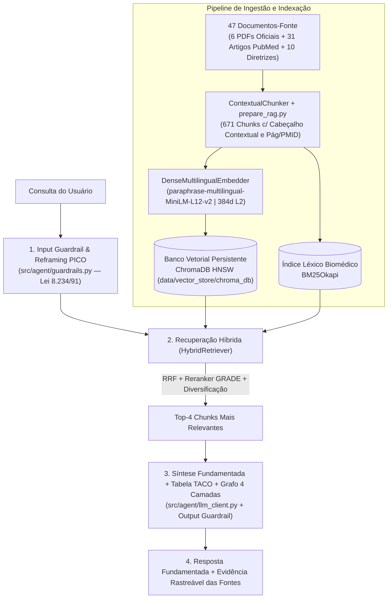

# CultivaProjetoFase1 — Módulo de Nutrição Baseada em Evidências (`rag-hibrido`)

Projeto: **CULTIVA**, um aplicativo que usa IA para ajudar jovens adultos e estudantes (18+) a transformar bons hábitos em decisões simples e sustentáveis, sem substituir o profissional de saúde. Alinhado aos ODS 3 (Saúde e Bem-Estar) e 4 (Educação de Qualidade).

📄 **Documentação Completa da Entrega (Artefatos, Chunking, Embeddings, Banco Vetorial, Arquitetura e Ingestão):**
👉 Consulte [`docs/entrega-rag-nutricao.md`](docs/entrega-rag-nutricao.md)

---

## Consultor Científico de Nutrição Baseado em Evidências (RAG Híbrido + ChromaDB + TACO + Grafo Causal)

Implementação completa de um consultor de nutrição baseado em evidências científicas e diretrizes oficiais, operando com **Banco Vetorial Persistente (`ChromaDB` + Embeddings Multilíngues de 384d)**, **API gratuita da Groq (`openai/gpt-oss-120b` / `qwen/qwen3.8-27b`)** (com fallback opcional para **Ollama local `qwen2.5:7b`** e síntese extrativa determinística) e respeitando rigorosamente os limites da **Lei Federal nº 8.234/1991 (Art. 3º - CFN)**.

---

## Resumo dos Artefatos da Entrega

1. **Base de Conhecimento Curada (`>= 20` Documentos-Fonte):**
   * **47 documentos-fonte únicos** (**37 documentos-fonte primários verificáveis** + **10 sínteses normativas**), totalizando **671 chunks contextualizados**:
     * **6 Documentos Oficiais Completos em PDF** catalogados em [`corpus/manifest.yaml`](corpus/manifest.yaml) e auditados por SHA-256 (*Guia Alimentar MS 2014*, *Fascículo 1 MS/USP 2021*, *Martins et al. SciELO 2013*, *Souza & Backes SciELO 2020*, *Guia Vegetariano SVB 2012* e *Moreira & Rodrigues SciELO 2014*).
     * **31 Meta-Análises e Revisões Sistemáticas Reais do PubMed** (coletadas via API NCBI Entrez com `PMID` e `DOI` individuais verificáveis).
     * **10 Sínteses Normativas de Diretrizes Clínicas** (SBD, SBC, ISSN, IOC) + **597 Alimentos da Tabela TACO 4ª Edição (Unicamp) / TBCA-USP**.
2. **Estratégia de Chunking (`corpus/scripts/prepare_rag.py` & `src/ingestion/contextual_chunker.py`):**
   * **Page-Aware & Section-Aware Chunking:** Limpeza de sumários, referências e rodapés repetitivos; preservação estrita das fronteiras de página física (`pagina_pdf`) e seção; limite de `1200` caracteres cortado exclusivamente em fronteiras de sentença.
   * **Contextual Retrieval Header:** Injeção automática do cabeçalho `[Documento | Fonte (Ano) | Domínio | Nível de Evidência GRADE | Seção/Pág]` em cada chunk.
3. **Estratégia de Embeddings (`src/retrieval/vector_store.py` & `src/retrieval/hybrid_retriever.py`):**
   * Modelo denso multilíngue **`sentence-transformers/paraphrase-multilingual-MiniLM-L12-v2`** (`384` dimensões, normalização L2 para similaridade de cosseno) permitindo busca *cross-lingual* (PT-BR $\leftrightarrow$ EN), combinado com representação contextual LSA e fundido ao índice léxico `BM25Okapi` via **Reciprocal Rank Fusion (RRF, $k=60$)** + Reranker Clínico `GRADE` + Diversificação Documental (`MAX_CHUNKS_PER_DOC=2`).
4. **Banco Vetorial Persistente (`src/retrieval/vector_store.py`):**
   * Implementado com **ChromaDB (`PersistentClient`)** em `data/vector_store/chroma_db`, utilizando índice **HNSW (`cosine`)** e armazenamento relacional de metadados (`source_id`, `doc_id`, `evidence_level`, `license`, `review_status`, `page_number`).

---

## Diagrama de Arquitetura e Pipeline de Ingestão



---

## Como Executar

### 1. Instalar dependências e verificar integridade do Corpus Oficial
```bash
uv sync
uv run python corpus/scripts/verify_corpus.py
```

### 2. Executar a Demonstração Oficial da Entrega (Artefatos + Consulta + Chunks + Resposta + Fontes)
```bash
# Executa a auditoria dos artefatos (>= 20 fontes, chunking, embeddings, ChromaDB) e 3 consultas completas:
uv run python -m src.demo_entrega

# Ou submeta uma pergunta específica na demonstração:
uv run python -m src.demo_entrega "Como a fibra solúvel da aveia age para reduzir o colesterol LDL e a glicemia?"
```

### 3. Rodar a suíte de testes automatizados (26 testes)
```bash
uv run pytest -v
```

### 4. Executar o Benchmark (16 questões) e Estudo de Ablação
```bash
# Estudo de Ablação rápido (Passo 1 vs. Passo 2 vs. Passo 3):
uv run python -m src.evaluation.run_benchmark --no-ollama --ablation

# Benchmark completo com LLM (Groq / Ollama):
uv run python -m src.evaluation.run_benchmark
```

### 5. Fazer uma consulta via CLI ou API FastAPI
```bash
# Consulta via CLI (exibe Chunks Recuperados, Síntese, Grafo, TACO e Citações):
uv run python -m src.api "Como a fibra solúvel da aveia age para reduzir o colesterol LDL e a glicemia?"

# Subir servidor FastAPI (Swagger em http://localhost:8000/docs):
uv run uvicorn src.api:app --reload
```
