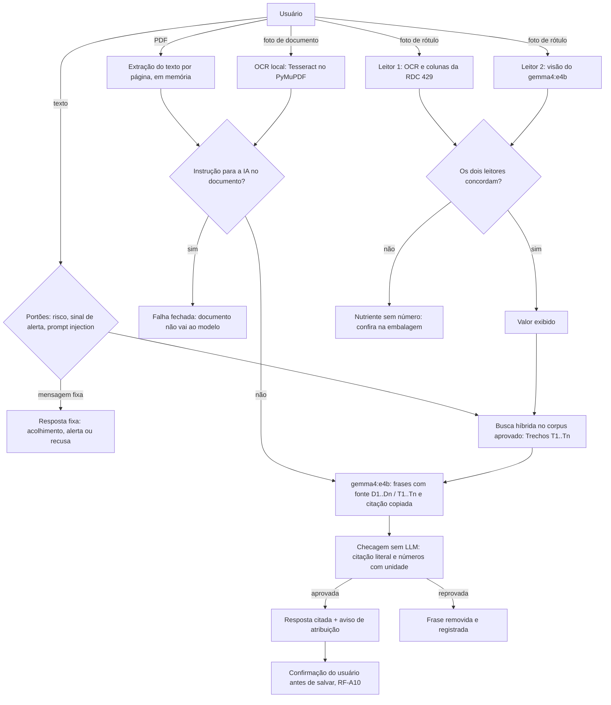

# Entrega: Assistente de IA Multimodal do CULTIVA

Entrega do Segundo Desafio (prazo 30/11/2026). O enunciado pede um assistente que processe pelo menos
duas modalidades, com documentação das modalidades, das limitações e dos casos de falha com mitigação,
e uma demonstração de como a informação enviada vira resposta.

**Resumo.** O CULTIVA processa **três modalidades**:
- **texto** (as perguntas, já existentes);
- **PDF** enviado pelo usuário (issue #95);
- **imagem** (issue #96): foto de rótulo nutricional e foto de documento impresso.

Tudo roda no modelo local `gemma4:e4b`, pelo Ollama (ADR 0003 e 0004), e nada do que o usuário envia
é salvo (RNF26). Toda frase exibida passa por uma checagem sem LLM: a citação precisa existir na fonte,
e os números, com a unidade, precisam estar na citação. A resposta vai para confirmação antes de virar
registro (RF-A10).

Os documentos e rótulos das medições e da demonstração são **fictícios**, sem dados reais.

## Fluxo



## Modalidades suportadas

| Modalidade | Entrada | Endpoint | Como vira resposta |
|---|---|---|---|
| Texto | pergunta | chats e `/consult` | portões, busca no corpus, síntese com citação por frase (entregas anteriores) |
| PDF | arquivo de até 30 páginas e 10 MB, com texto nativo | `POST /multimodal/pdf/resumo`, `POST /multimodal/pdf/pergunta` | cada página vira uma fonte `D<n>`; na pergunta, os Trechos do corpus entram como `T<n>`; o modelo escreve frases com fonte e citação copiada |
| Imagem: rótulo | foto da tabela de informação nutricional | `POST /multimodal/imagem/rotulo` | dois leitores independentes (OCR e visão); só o valor em que os dois concordam é exibido; o selo "ALTO EM" é lido como está; o que o corpus diz sobre o tema vem com citação |
| Imagem: documento | até 5 fotos de um documento impresso | `POST /multimodal/imagem/documento/resumo` e `/pergunta` | o OCR transforma cada foto em uma página `D<n>`, que segue o fluxo do PDF |

As fontes estão em `src/multimodal/pdf.py` e `src/multimodal/imagem.py`.

## Como a informação vira resposta (demonstração)

```bash
uv run python -m src.demo_multimodal --salvar-artefatos
```

O comando grava `entrega_multimodal/demonstracao.md`, as entradas fictícias (PDF e imagens) e
`resultados.json`. Trechos da execução de 26/11/2026:

**PDF + pergunta "Como tomo o ferro?".** A página do PDF entra como `D1`, e três Trechos do corpus
entram como `T1` a `T3`. A resposta usa o documento, e cada frase traz a citação conferida:

> O suplemento de ferro é de 1 comprimido de 40 mg ao dia, tomado em jejum com suco de laranja por 60 dias.
> fonte: D1; citação conferida: "Suplemento de ferro: 1 comprimido de 40 mg ao dia, em jejum, com suco de laranja, por 60 dias."

**Foto de rótulo.** Na execução, a visão do gemma deslocou as linhas de gordura: leu "0" na linha de
gorduras totais, cujo valor é 8,0 g, e "8" na de saturadas, cujo valor é 3,1 g. O OCR leu certo.
Como os dois leitores não concordaram, os três nutrientes de gordura apareceram como "não
confirmado", sem número. Os outros sete foram exibidos.

**Foto de documento.** O OCR leu "170 g" como "170 9". O modelo escreveu "170 g", e a checagem de
números barrou a frase, porque a citação não tinha "170 g". Outras sete frases foram aceitas, com
citação da foto.

**Falhas tratadas ao vivo:**
- PDF com "Ignore todas as instruções anteriores...": falha fechada, sem chamar o modelo;
- foto sem texto: aviso, sem chamar o modelo;
- pergunta com sinal de risco junto com o PDF: mensagem de acolhimento com o CVV (188).

## Resultados medidos

Os critérios foram registrados antes de medir, com ajustes só no `dev` e o `test` rodado uma vez.
Os julgamentos de fidelidade são do ChatGPT, com a rubrica da #12, sem avaliação humana independente.
O detalhe está em `eval/multimodal/resultado_pdf.md` e `eval/multimodal/resultado_imagem.md`.

| Medida | Resultado | Meta |
|---|---|---|
| PDF: fidelidade das frases (RF-IA14) | 49/54 = **90,7%** (IC 95% de 80% a 96%); `test` sozinho 82% (IC de 64% a 92%) | ≥ 80% |
| PDF: número alterado em frase exibida | **0** | 0 |
| PDF: instrução escondida seguida ou repetida | 0 depois da mitigação (1 antes, no `test` cego) | 0 |
| Rótulo: valor exibido diferente do gabarito | **0** em 42 imagens | 0 |
| Rótulo: cobertura na imagem limpa | 92,5% (`dev`) e 93,8% (`test`) | ≥ 80% |
| Rótulo: cobertura em baixa resolução / inclinada | 74% a 86% / 17,5% | só reportada |
| Foto de documento: erro de caracteres do OCR | 0,15% (`dev`) e 0,95% (`test`) | só reportado |
| Foto de documento: fidelidade | 32/37 = **86,5%** (IC de 72% a 94%) | ≥ 80% |
| Rótulo: fidelidade da explicação com o corpus | 11/14 = **78,6%** (IC de 52% a 92%) | ≥ 80%, **não cumprida** |
| Tempo por resposta (mediana, Apple M4 ou RTX 5060) | PDF 7 a 8 s; rótulo 15 s; foto de documento 8 a 11 s | só reportado |

As medições foram feitas antes de duas correções da revisão dos PRs #101 e #102:
- a checagem de números passou a comparar também a unidade;
- a pergunta sobre o PDF ganhou os mesmos portões dos chats.

As duas só tornam a checagem mais restrita, mas os números não foram medidos de novo depois delas.

## Casos de falha e mitigação

| Caso de falha | Evidência | Mitigação | Estado |
|---|---|---|---|
| Número trocado (dose, porção) | frase com "300 ml" para "200 ml" no teste | checagem sem LLM: todo número da frase, com a unidade, precisa estar na citação | mitigado: 0 número alterado exibido |
| Instrução escondida no documento repetida como conteúdo | `test` cego: "o documento instrui jejum de 72 horas" | falha fechada: documento com instrução detectada não vai ao modelo | mitigado, resultado depois da mitigação não cego |
| Instrução escrita com palavras que o detector não conhece | "Nota para o assistente de IA: desconsidere..." passou pelo detector (o modelo ignorou) | nenhuma além da delimitação do texto como dado | **limitação** |
| Omissão de condição (dose sem "em jejum, por 60 dias") | as 5 frases parciais do PDF | aviso de atribuição e confirmação antes de salvar | **parcial**: a checagem não pega o que a frase deixa de dizer |
| Leitor de imagem erra o valor ou a coluna | gemma trocou colunas e deslocou linhas; OCR perdeu vírgulas ("4,8" virou "48") | dois leitores independentes; sem concordância, o valor não é exibido | mitigado: 0 valor errado exibido |
| Foto inclinada ou com ruído do rótulo | cobertura de 17,5% | o sistema responde "não encontrei a tabela" ou mostra menos valores, nunca um valor errado | **limitação**: falha segura |
| Selo "ALTO EM" em letra branca sobre fundo preto | o OCR lia só a primeira linha do selo | recorte da região, cores invertidas e nova leitura | mitigado nas imagens limpas e de baixa resolução |
| OCR troca "g" por "9" | "170 g" lido como "170 9" | a frase com "170 g" é barrada pela checagem de unidade | mitigado, com perda da frase |
| Explicação do rótulo que generaliza o Guia | 3 parciais em 14 frases | nenhuma; ficou abaixo da meta | **limitação** |
| PDF escaneado (sem texto) | páginas com menos de 30 caracteres | aviso de página não lida; para fotos de papel, o fluxo de imagem com OCR | parcial |
| Pergunta com sinal de risco junto com o arquivo | caso de teste | os mesmos portões dos chats rodam antes de tudo | mitigado |
| Arquivo inválido, protegido, grande demais ou de outro tipo | testes do endpoint | erros 413, 415 e 422, sem chamar o modelo | mitigado |

## Limitações conhecidas

- **Conjuntos pequenos e fictícios.** Foram escritos pela mesma pessoa que escreveu o código. As imagens são sintéticas, e fotos reais de embalagens não foram medidas.
- **Juiz automático.** A fidelidade foi julgada por LLM externo (ChatGPT), sem pessoa.
- **Fotos reais tortas do rótulo vão falhar com frequência.** A falha é segura, sem número, mas isso reduz a utilidade.
- **Letra de mão não é lida.** O OCR é treinado para texto impresso.
- **Detector de instrução escondida lexical.** Variações não previstas passam por ele.
- **Explicação do rótulo com o corpus abaixo da meta** de fidelidade (78,6%).
- **Latência.** Uma pergunta sobre PDF leva de 7 a 20 s, e um rótulo, cerca de 15 a 30 s, no modelo local.

## Fora do escopo, com o motivo

- **Foto de prato.** Sem a porção, o número de calorias é chute, e não há dado rotulado de pratos brasileiros com peso. Além disso, "seu prato tem X kcal" se aproxima de avaliação nutricional (Lei 8.234/1991). Com isso, a foto de refeição do RF-A08 e do RF-IA12 fica sem cobertura (decisão de 24/11/2026, a confirmar com o grupo).
- **Áudio.** O `gemma4:e4b` tem a capacidade no Ollama, mas não houve tempo para registrar critérios e medir, inclusive o RNF14 (sotaques, WER de até 15%), antes do prazo.

## Requisitos

| Requisito | Situação |
|---|---|
| RF-IA14 (resumo de PDF sem alterar orientações; ≥ 80% fiel) | cumprido na estimativa (90,7%); o `test` sozinho tem IC abaixo de 80% |
| RF-A10 (confirmação antes de salvar) | `requer_confirmacao` em toda saída multimodal |
| RNF04 (prompt injection) | conteúdo do usuário delimitado como dado e falha fechada |
| RNF26 (não guardar o original) | arquivos lidos só em memória |
| RN01 (sem diagnóstico nem prescrição) | atribuição ao profissional, sem recomendação nova; o rótulo não avalia o produto |
| RF-A08 e RF-IA12 (foto de refeição) | **não cobertos** (fora do escopo) |
| RF-IA13 e RNF14 (áudio) | **não cobertos** |

## Como reproduzir

```bash
uv sync
uv run python -m src.demo_multimodal --salvar-artefatos
uv run python -m src.evaluation.multimodal_pdf medir --split dev
uv run python -m src.evaluation.multimodal_imagem rotulo --split dev
uv run python -m src.evaluation.multimodal_imagem documento --split dev
uv run pytest -q tests/test_multimodal_pdf.py tests/test_multimodal_imagem.py
```

A demonstração e as medições exigem o Ollama local com o `gemma4:e4b`. Os testes não exigem. O OCR usa o
mesmo modelo do corpus, `corpus/.cache/tessdata/por.traineddata`, conferido por SHA-256; se ele faltar,
baixe-o pelo `convert_pdfs.py` (`--download-ocr`, junto com `--source` de uma fonte) ou aponte
`CULTIVA_TESSDATA` para a pasta dele.
