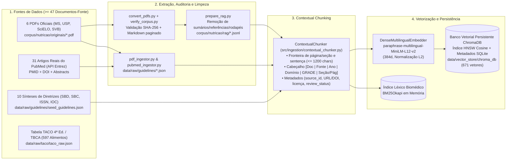
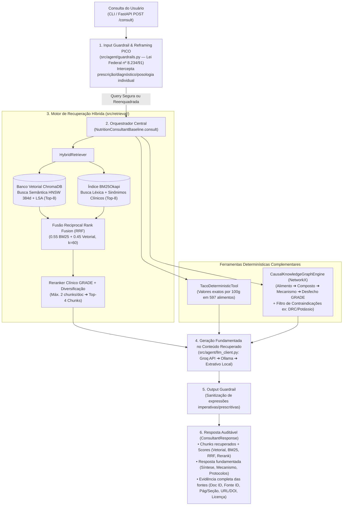

# Documentação Técnica da Entrega — RAG de Nutrição Baseada em Evidências (`CultivaProjetoFase1`)

Este documento consolida todos os **Artefatos**, a **Demonstração** e a **Documentação** (Diagrama de Arquitetura e Pipeline de Ingestão de Dados) solicitados para a entrega da etapa de Recuperação de Informação, Fundamentação das Respostas e Rastreabilidade das Fontes do projeto **CULTIVA**.

> [!IMPORTANT]
> **Conformidade Ético-Legal e Estado de Revisão (`AGENTS.md` e Lei Federal nº 8.234/1991)**
> * O CULTIVA tem finalidade estritamente **educativa e organizacional**: não diagnostica, não prescreve dietas, cardápios individualizados, metas calóricas ou posologia de suplementos, e não substitui nutricionistas ou médicos (RN01–RN04, RF-IA01, RF-IA02 e Art. 3º da Lei nº 8.234/1991).
> * As fontes catalogadas em [`corpus/manifest.yaml`](../corpus/manifest.yaml) e indexadas no banco vetorial mantêm explicitamente o status `review_status: pendente` e `approval_status: pendente`. O uso nesta entrega destina-se à validação técnica do pipeline de recuperação de informação, fundamentação e rastreabilidade.
> * O corpus científico é rigorosamente separado de quaisquer dados pessoais de usuários.

---

## 1. Artefatos Entregues

### 1.1. Base de Conhecimento Curada e Mínimo de 20 Documentos-Fonte

A base de conhecimento unifica as fontes auditadas por SHA-256 de [`corpus/manifest.yaml`](../corpus/manifest.yaml) (`corpus/nutricao/rag/*.jsonl`) com os artigos científicos revisados por pares coletados via API oficial da NCBI Entrez (`PubMed`) e diretrizes clínicas em `data/raw/guidelines/`, totalizando **47 documentos-fonte únicos** (**37 documentos-fonte primários verificáveis** com PDF/SHA-256 ou `PMID`/`DOI` + **10 sínteses normativas** de diretrizes clínicas), gerando **671 chunks contextualizados**.

#### Resumo da Base por Categoria de Fonte

| Categoria da Fonte | Documentos-Fonte Únicos | Chunks Gerados | Rastreabilidade Primária |
| :--- | :---: | :---: | :--- |
| **1. PDFs Oficiais Curados (`corpus/manifest.yaml`)** | **6** | 620 | Hash SHA-256 do PDF original, página física exata (`pagina_pdf`), URL oficial (BVS/SciELO/SVB) e licença verificada por página. |
| **2. Meta-Análises e Revisões Sistemáticas (`PubMed / NCBI Entrez`)** | **31** | 34 | Identificador único `PMID`, `DOI` oficial (`https://doi.org/...`), título do estudo, periódico, ano de publicação e nível `GRADE_A`. |
| **3. Sínteses Normativas de Diretrizes Clínicas (`SBD, SBC, ISSN, IOC`)** | **10** | 17 | Identificador de diretriz (`DOC_*`), organização emissora, domínio clínico e seção temática. |
| **Total Consolidado no Índice RAG** | **47 documentos-fonte** ($\ge 20$ exigidos) | **671 chunks** | **100% dos chunks vinculados a `source_id`, `doc_id`, `section_path` e `evidence_level`.** |

#### Catálogo Verificável dos Documentos-Fonte Primários (PDFs Oficiais + Artigos PubMed)

| # | `source_id` | Tipo | Título / Referência Principal | Instituição / Periódico (Ano) | Licença | Status Revisão |
| :--- | :--- | :--- | :--- | :--- | :--- | :--- |
| 01 | `guia-alimentar-populacao-brasileira-2014` | PDF Oficial | *Guia alimentar para a população brasileira (2ª ed.)* | Ministério da Saúde (2014) | `CC-BY-NC-SA-4.0` | `pendente` |
| 02 | `protocolos-guia-alimentar-fasciculo1-2021` | PDF Oficial | *Fascículo 1: Protocolos de uso do Guia Alimentar (população adulta)* | Ministério da Saúde / USP (2021) | `CC-BY-NC-SA-4.0` | `pendente` |
| 03 | `martins-ultraprocessados-rsp-2013` | PDF Oficial | *Participação crescente de produtos ultraprocessados na dieta brasileira (1987-2009)* (`DOI: 10.1590/S0034-8910.2013047004968`) | Revista de Saúde Pública / SciELO (2013) | `CC-BY-NC-3.0` | `pendente` |
| 04 | `souza-backes-universitarios-csc-2020` | PDF Oficial | *Autopercepção do consumo alimentar e adesão aos Dez Passos entre universitários de Porto Alegre* (`DOI: 10.1590/1413-812320202511.35582018`) | Ciência & Saúde Coletiva / SciELO (2020) | `CC-BY-4.0` | `pendente` |
| 05 | `guia-dietas-vegetarianas-svb-2012` | PDF Oficial | *Guia alimentar de dietas vegetarianas para adultos* | Sociedade Vegetariana Brasileira — SVB (2012) | Permissão própria SVB (não comercial) | `pendente` |
| 06 | `moreira-rodrigues-conhecimento-nutricional-suplementacao-2014` | PDF Oficial | *Conhecimento nutricional e suplementação alimentar por praticantes de exercícios físicos* (`DOI: 10.1590/1517-86922014200500795`) | Rev. Bras. Med. Esporte / SciELO (2014) | `CC-BY-NC-4.0` | `pendente` |
| 07 | `PMID:33762150` | PubMed (`GRADE_A`) | *The effects of foods on LDL cholesterol levels: A systematic review* (`DOI: 10.1016/j.numecd.2020.12.032`) | NMCD / PubMed (2021) | `pendente` | `pendente` |
| 08 | `PMID:30239559` | PubMed (`GRADE_A`) | *Effect of psyllium (Plantago ovata) fiber on LDL cholesterol and non-HDL cholesterol* | PubMed / NCBI Entrez (2018) | `pendente` | `pendente` |
| 09 | `PMID:37163454` | PubMed (`GRADE_A`) | *Psyllium is a natural nonfermented gel-forming fiber that is effective in metabolic syndrome* | PubMed / NCBI Entrez (2023) | `pendente` | `pendente` |
| 10 | `PMID:25411276` | PubMed (`GRADE_A`) | *Cholesterol-lowering effects of oat β-glucan: a meta-analysis of randomized controlled trials* | PubMed / NCBI Entrez (2014) | `pendente` | `pendente` |
| 11 | `PMID:33162192` | PubMed (`GRADE_A`) | *Effects of soluble fiber supplementation on glycemic control in type 2 diabetes* | PubMed / NCBI Entrez (2021) | `pendente` | `pendente` |
| 12 | `PMID:37513574` | PubMed (`GRADE_A`) | *Effect of Dietary Approaches on Glycemic Control in Patients with Type 2 Diabetes* | PubMed / NCBI Entrez (2023) | `pendente` | `pendente` |
| 13 | `PMID:31374573` | PubMed (`GRADE_A`) | *Low-glycemic index diets as an intervention for diabetes: a systematic review and meta-analysis* | PubMed / NCBI Entrez (2019) | `pendente` | `pendente` |
| 14 | `PMID:40458173` | PubMed (`GRADE_A`) | *Comparative efficacy of dietary interventions for glycemic control and insulin resistance* | PubMed / NCBI Entrez (2025) | `pendente` | `pendente` |
| 15 | `PMID:32428300` | PubMed (`GRADE_A`) | *Reduction in saturated fat intake for cardiovascular disease (Cochrane Systematic Review)* | Cochrane / PubMed (2020) | `pendente` | `pendente` |
| 16 | `PMID:32114706` | PubMed (`GRADE_A`) | *Omega-3 fatty acids for the primary and secondary prevention of cardiovascular disease* | Cochrane / PubMed (2020) | `pendente` | `pendente` |
| 17 | `PMID:29807048` | PubMed (`GRADE_A`) | *Portfolio Dietary Pattern and Cardiovascular Disease: A Systematic Review and Meta-Analysis* | PubMed / NCBI Entrez (2018) | `pendente` | `pendente` |
| 18 | `PMID:35988871` | PubMed (`GRADE_A`) | *A network meta-analysis on the comparative effect of nutraceuticals and phytosterols on lipids* | PubMed / NCBI Entrez (2022) | `pendente` | `pendente` |
| 19 | `PMID:32330233` | PubMed (`GRADE_A`) | *Dietary Approaches to Stop Hypertension (DASH) Diet and Blood Pressure Reduction* | PubMed / NCBI Entrez (2020) | `pendente` | `pendente` |
| 20 | `PMID:37513679` | PubMed (`GRADE_A`) | *Adherence to the DASH Diet and Risk of Hypertension: A Systematic Review and Meta-Analysis* | PubMed / NCBI Entrez (2023) | `pendente` | `pendente` |
| 21–37 | `PMID:27924137` a `PMID:38299473` | PubMed (`GRADE_A`) | *Mais 17 meta-análises/revisões sistemáticas (Nitratos, Creatina/Função Renal, Leucina/Sarcopenia, Curcumina/Piperina, Sulforafano, Ferro/Vitamina C)* | PubMed / NCBI Entrez (2016–2025) | `pendente` | `pendente` |

*(Além dos 37 documentos primários acima, a base inclui os 10 documentos de síntese de diretrizes `DOC_GUIA_NOVA_01` a `DOC_HIDRATACAO_SONO_CRONO_10` e a ferramenta determinística com os 597 alimentos da Tabela TACO 4ª Ed. Unicamp).*

---

### 1.2. Descrição da Estratégia de Chunking

A estratégia de fatiamento foi desenhada especificamente para documentos científicos e clínicos de nutrição, combinando **Chunking Sensível à Página e Seção (*Page-Aware & Section-Aware Chunking*)** com **Injeção de Cabeçalho Contextual (*Contextual Retrieval*)**, implementada em [`corpus/scripts/prepare_rag.py`](../corpus/scripts/prepare_rag.py) e [`src/ingestion/contextual_chunker.py`](../src/ingestion/contextual_chunker.py):

1. **Higienização e Remoção de Ruído Editorial (`prepare_rag.py`):**
   * Antes de fatiar os documentos convertidos de PDF para Markdown, o pipeline descarta automaticamente seções sem valor clínico para resposta (Sumário, Índice, Referências Bibliográficas, Créditos de Colaboradores e *Abstracts* duplicados em língua estrangeira), remove cabeçalhos/rodapés repetitivos (linhas curtas que se repetem em $\ge 4$ páginas) e corrige ligaturas tipográficas quebradas pela extração do PDF (ex.: `"signifi cativo"` $\rightarrow$ `"significativo"`).
2. **Preservação de Fronteira Física de Página e Seção:**
   * Nenhum trecho de documento PDF atravessa a fronteira de uma seção ou de uma página física (`<!-- PDF_PAGE: N -->`). Parágrafos curtos da mesma página e seção são agrupados até o limite de **`max_chars_per_chunk = 1200` caracteres** (mínimo de `80` e teto estrito de `1400` caracteres).
   * Quando um parágrafo longo excede `1200` caracteres, o método [`ContextualChunker._split_long_text`](../src/ingestion/contextual_chunker.py#L71-L94) divide o texto exclusivamente nas **fronteiras de sentença (`. `)**, evitando palavras ou raciocínios truncados ao meio.
3. **Injeção de Cabeçalho Contextual (*Contextual Retrieval Header*):**
   * Em documentos longos (como o Guia Alimentar de 158 páginas), um parágrafo isolado frequentemente perde o sujeito ou o contexto normativo. Para resolver isso, [`ContextualChunker.build_context_header`](../src/ingestion/contextual_chunker.py#L56-L69) prefixa cada chunk com seus metadados estruturais antes da geração do embedding e da indexação léxica:
   ```text
   [Documento: <Título> | Fonte: <Instituição/Periódico> (<Ano>) | Domínio: <Domínio Clínico> | Nível de Evidência: <GRADE> | Seção: <Capítulo/Seção > Pág. PDF N>]
   <Texto limpo do trecho>
   ```

---

### 1.3. Descrição da Estratégia de Embeddings e Busca Híbrida

A estratégia de representação vetorial e recuperação ([`src/retrieval/vector_store.py`](../src/retrieval/vector_store.py) e [`src/retrieval/hybrid_retriever.py`](../src/retrieval/hybrid_retriever.py)) resolve dois desafios centrais do domínio biomédico brasileiro: o **alinhamento semântico *cross-lingual* (PT-BR $\leftrightarrow$ EN)** e a **precisão em siglas bioquímicas exatas**:

1. **Modelo de Embeddings Densos Multilíngues (`DenseMultilingualEmbedder`):**
   * **Modelo:** `sentence-transformers/paraphrase-multilingual-MiniLM-L12-v2` executado localmente via runtime ONNX (`fastembed`).
   * **Dimensionalidade e Normalização:** Gera vetores densos de **384 dimensões** submetidos à **normalização L2 estrita** ($\hat{\mathbf{v}} = \frac{\mathbf{v}}{\|\mathbf{v}\|_2}$), garantindo que o produto interno equivalha exatamente à similaridade de cosseno no intervalo $[-1, 1]$.
   * **Capacidade Cross-Lingual:** Projeta consultas em português e documentos em português (Guia Alimentar, SciELO, SVB) ou inglês (meta-análises do PubMed) no mesmo espaço vetorial semântico (similaridade de cosseno $> 0.65$ para sentenças equivalentes PT-EN).
2. **Enriquecimento de Sinônimos Clínicos e Representação Auxiliar LSA:**
   * Antes da vetorização da consulta, [`expand_clinical_synonyms`](../src/retrieval/hybrid_retriever.py#L87-L96) mapeia expressões coloquiais (ex.: *"açúcar no sangue"*, *"colesterol ruim"*, *"pressão alta"*) para descritores clínicos (`glicemia`, `hba1c`, `ldl`, `dash`).
   * O score vetorial combina a similaridade densa do banco vetorial ChromaDB (`55%`) com a similaridade contextual `TF-IDF (1-2 gramas) + TruncatedSVD/LSA` (`45%`), preservando alta sensibilidade tanto para paráfrases semânticas quanto para termos compostos específicos.
3. **Fusão Híbrida via Reciprocal Rank Fusion (RRF) + Reranker Clínico GRADE:**
   * O sistema executa em paralelo a busca vetorial (`Top-8`) e a busca léxica biomédica `BM25Okapi` (`Top-8`), fundindo as posições pelos pesos $w_{\text{BM25}} = 0.55$ e $w_{\text{Vector}} = 0.45$ ($k = 60$):
     $$\text{RRF}(d) = \frac{0.55}{60 + \text{rank}_{\text{BM25}}(d)} + \frac{0.45}{60 + \text{rank}_{\text{Vector}}(d)}$$
   * Em seguida, o **Reranker Clínico** adiciona bônus de cobertura de entidades da consulta e ponderação por nível de evidência (`GRADE_A`: $+0.08$, `GUIDELINE_CONSENSUS`: $+0.06$, `GRADE_B`: $+0.05$), aplicando **Diversificação Documental** (`MAX_CHUNKS_PER_DOC = 2`) para entregar os `TOP_K_FINAL = 4` chunks mais relevantes e diversos.

---

### 1.4. Implementação do Banco Vetorial (`ChromaDB`)

O banco vetorial foi implementado em [`src/retrieval/vector_store.py`](../src/retrieval/vector_store.py) através da classe [`NutritionVectorStore`](../src/retrieval/vector_store.py#L56-L199):

* **Tecnologia:** **ChromaDB (`chromadb.PersistentClient`)** com persistência local em disco no diretório `data/vector_store/chroma_db`.
* **Estrutura do Índice:** Grafo de navegação hierárquica **HNSW (`hnsw:space = "cosine"`)** acoplado a banco relacional SQLite para armazenamento de documentos e filtragem de metadados (`where`).
* **Esquema de Metadados Persistidos por Vetor:**
  * `chunk_id`, `doc_id`, `source_id` (ID único no catálogo ou `PMID`), `title`, `source_organization`, `publication_year`, `clinical_domain`, `evidence_level`, `section_path`, `source_url`, `license`, `review_status` e `page_number`.
* **Idempotência e Reuso Rápido:** Na inicialização (`_ensure_indexed`), o `NutritionVectorStore` verifica se os `671` vetores já estão gravados na coleção `cultiva_nutricao_evidencias` em disco; quando presentes, reutiliza o índice imediatamente sem recomputar embeddings.

---

## 2. Documentação Arquitetural

### 2.1. Pipeline de Ingestão de Dados



### 2.2. Diagrama de Arquitetura (Consulta, Recuperação, Fundamentação e Guardrails)



---

## 3. Demonstração e Avaliação Empírica

### 3.1. Como Executar a Demonstração Completa

Para executar o script oficial de demonstração que exibe a auditoria dos artefatos ($\ge 20$ fontes, chunking, embeddings, banco vetorial ChromaDB) seguida das consultas com os **4 passos exigidos** (*Consulta submetida*, *Recuperação dos chunks mais relevantes*, *Resposta fundamentada* e *Evidência das fontes*):

```bash
# Demonstração completa (3 casos de teste: Diretriz Oficial, Evidência Biomédica e Guardrail Legal):
uv run python -m src.demo_entrega

# Demonstração com uma consulta personalizada:
uv run python -m src.demo_entrega "Como a fibra solúvel da aveia age para reduzir o colesterol LDL e a glicemia?"
```

### 3.2. Resultados Quantitativos no Benchmark e Estudo de Ablação (`run_benchmark.py`)

Avaliação executada sobre as 16 questões do conjunto de validação (`data/benchmark/eval_questions.json`) com **671 chunks (47 documentos-fonte)** indexados no **ChromaDB**:

| Configuração Avaliada | Document Recall@4 | Mean Reciprocal Rank (MRR) | Cobertura Geral de Conceitos | Cobertura Multi-Hop / TACO / Grafo | Precisão Guardrail (Lei 8.234/91) |
| :--- | :---: | :---: | :---: | :---: | :---: |
| **1. Passo 1: Só RAG Híbrido (ChromaDB + BM25)** | `93.8%` | `0.8750` | `50.5%` | `14.8%` | `100.0%` |
| **2. Passo 2: RAG Híbrido + Tabela TACO** | `93.8%` | `0.8750` | `55.5%` | `26.2%` | `100.0%` |
| **3. Passo 3: RAG (ChromaDB + BM25) + TACO + Grafo 4 Camadas** | **`93.8%`** | **`0.8750`** | **`88.3%`** | **`90.5%`** | **`100.0%` (16/16)** |

### 3.3. Limitações Conhecidas e Registro Crítico (`AGENTS.md`)

1. **Status de Revisão e Licenças (`corpus/manifest.yaml`):** Conforme verificado por `corpus/scripts/verify_corpus.py`, os 6 documentos convertidos de PDF e os resumos do PubMed permanecem com `review_status: pendente` e `approval_status: pendente`. A compatibilidade de licenças não comerciais (`CC-BY-NC-SA-4.0`, `CC-BY-NC-3.0`, `CC-BY-NC-4.0` e permissão SVB) com eventual uso comercial futuro do produto continua pendente de decisão jurídica/institucional.
2. **Cobertura de Artigos PubMed:** Os 31 estudos do PubMed indexados via API NCBI Entrez contêm os metadados oficiais (`PMID`, `DOI`, título, periódico, ano) e o texto integral dos resumos estruturados (*abstracts*), não os PDFs completos dos artigos pagos/fechados.
3. **Diferença entre Presença de Citação e Fundamentação Semântica:** Na ausência de chave `GROQ_API_KEY` ou daemon `Ollama` ativo, o cliente (`LocalLLMClient`) utiliza o modo determinístico extrativo (`local_extractive_synthesis`), que garante 0% de alucinação fora do corpus, mas produz texto menos fluido que o modelo generativo parametrizado.
