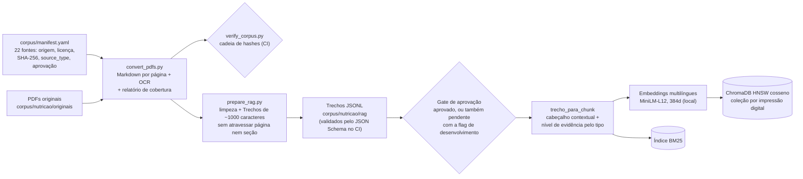
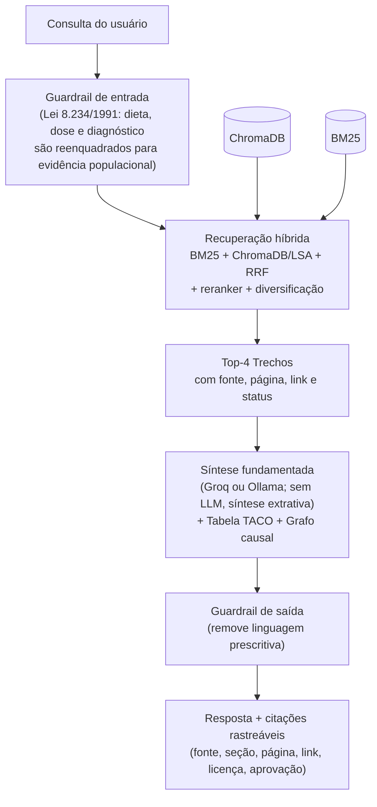

# Entrega: RAG de Nutrição com base curada, banco vetorial e rastreabilidade de fontes

> **Estado das fontes.** As 22 fontes do corpus estão catalogadas em [`corpus/manifest.yaml`](../corpus/manifest.yaml). Na data da entrega, duas estavam aprovadas (`approval_status: aprovado`) e 20 seguiam `pendente`; depois, o PR de aprovação do corpus aprovou mais 19, e só a SBAN segue `pendente` ([`revisao-aprovacao-corpus.md`](../corpus/nutricao/relatorios/revisao-aprovacao-corpus.md)). Os números desta entrega foram medidos antes dessa aprovação. Esta entrega roda em **modo de desenvolvimento explícito**, que indexa também as pendentes (flag `incluir_pendentes`, ADR 0002 e issue #7). Em produção, só fontes aprovadas entram no índice. O uso das fontes segue o aceite de risco de licenças para projeto acadêmico sem fins lucrativos ([`corpus/README.md`](../corpus/README.md)).

Os números deste documento foram gerados pelo sistema, não escritos à mão: `uv run python -m src.demo_entrega --salvar-artefatos` regrava os artefatos em [`entrega_semanal/`](../entrega_semanal/), e `uv run python -m src.evaluation.run_benchmark --no-ollama` regrava o benchmark.

## 1. Artefatos

### 1.1 Base de conhecimento curada (22 documentos-fonte)

A base é o corpus de Nutrição: **22 documentos-fonte em PDF** (mínimo exigido: 20), convertidos e divididos em **1873 Trechos**. Cada fonte tem origem, licença, versão e SHA-256 do PDF no manifesto, e o `verify_corpus.py` confere a cadeia de hashes no CI (job "Integridade do corpus").

Ficaram **fora** do índice:

- as 10 "sínteses normativas" de `data/raw/guidelines/seed_guidelines.json`, que não têm origem verificável;
- a cópia do Guia Alimentar em `data/raw` (o Guia entra pelo corpus, com página e hash);
- os 31 resumos do PubMed, por estarem em inglês e serem só resumos. O pipeline já aceita esse tipo de fonte (`kind: resumo_pubmed`), e a reinclusão é a issue #28.

| # | Fonte (`fonte_id`) | Tipo | Ano | Trechos | Licença | Aprovação |
|---:|---|---|---:|---:|---|---|
| 1 | Posicionamento sobre o tratamento nutricional do sobrepeso e da obesid… (`abeso-posicionamento-tratamento-nutricional-obesidade-2022`) | diretriz | 2022 | 501 | pendente | pendente |
| 2 | Guia alimentar para a população brasileira (`guia-alimentar-populacao-brasileira-2014`) | diretriz | 2014 | 339 | CC-BY-NC-SA-4.0 | pendente |
| 3 | Guia alimentar de dietas vegetarianas para adultos (`guia-dietas-vegetarianas-svb-2012`) | diretriz | 2012 | 165 | permissão própria (SVB) | pendente |
| 4 | Fascículo 1: Protocolos de uso do Guia Alimentar para a população bras… (`protocolos-guia-alimentar-fasciculo1-2021`) | diretriz | 2021 | 87 | CC-BY-NC-SA-4.0 | pendente |
| 5 | Água, Hidratação e Saúde (`sban-agua-hidratacao-saude-2016`) | diretriz | 2016 | 55 | pendente | pendente |
| 6 | Modificações dietéticas, reposição hídrica, suplementos alimentares e … (`sbme-modificacoes-dieteticas-suplementos-rbme-2009`) | diretriz | 2009 | 103 | CC-BY-NC-4.0 | pendente |
| 7 | Código de Ética e de Conduta do Nutricionista (Resolução CFN nº 599/20… (`cfn-codigo-etica-conduta-nutricionista-2018`) | norma | 2018 | 59 | pendente | pendente |
| 8 | Effects of intermittent fasting on metabolism in men (`azevedo-jejum-intermitente-ramb-2013`) | revisao | 2013 | 38 | CC-BY-NC-4.0 | pendente |
| 9 | Relação entre sono e obesidade: uma revisão da literatura (`crispim-sono-obesidade-abem-2007`) | revisao | 2007 | 32 | CC-BY-NC-4.0 | pendente |
| 10 | Uma nova classificação de alimentos baseada na extensão e propósito do… (`monteiro-nova-classificacao-alimentos-csp-2010`) | revisao | 2010 | 53 | CC-BY-NC-4.0 | pendente |
| 11 | Ingestão dietética e fatores associados ao consumo alimentar de univer… (`rossetti-universitarios-consumo-alimentar-san-2015`) | revisao | 2015 | 33 | CC-BY-NC-4.0 | pendente |
| 12 | Depressão, ansiedade e estresse e o comportamento alimentar (`brisotto-depressao-ansiedade-estresse-rbtc-2022`) | estudo | 2022 | 43 | pendente | pendente |
| 13 | Contribuições da psicologia e da nutrição para a mudança do comportame… (`franca-psicologia-nutricao-comportamento-alimentar-epsic-2012`) | estudo | 2012 | 39 | CC-BY-NC-4.0 | pendente |
| 14 | Ansiedade, qualidade do sono e compulsão alimentar em adultos com sobr… (`fusco-ansiedade-sono-compulsao-reeusp-2020`) | estudo | 2020 | 43 | CC-BY-4.0 | pendente |
| 15 | Fatores associados ao consumo de frutas e hortaliças no Brasil, 2006 (`jaime-frutas-hortalicas-brasil-rsp-2009`) | estudo | 2009 | 32 | CC-BY-NC-4.0 | pendente |
| 16 | Impacto de alimentos ultraprocessados sobre o teor de micronutrientes … (`louzada-ultraprocessados-micronutrientes-rsp-2015`) | estudo | 2015 | 37 | CC-BY-NC-3.0 | pendente |
| 17 | Alimentos ultraprocessados e perfil nutricional da dieta no Brasil (`louzada-ultraprocessados-perfil-nutricional-rsp-2015`) | estudo | 2015 | 48 | CC-BY-NC-3.0 | pendente |
| 18 | Participação crescente de produtos ultraprocessados na dieta brasileir… (`martins-ultraprocessados-rsp-2013`) | estudo | 2013 | 34 | CC-BY-NC-3.0 | aprovado |
| 19 | Conhecimento nutricional e suplementação alimentar por praticantes de … (`moreira-rodrigues-conhecimento-nutricional-suplementacao-2014`) | estudo | 2014 | 29 | CC-BY-NC-4.0 | pendente |
| 20 | Perfil dos estudantes que cursam enfermagem: qualidade de vida, sono e… (`salvi-estudantes-enfermagem-sono-reben-2020`) | estudo | 2020 | 38 | CC-BY-4.0 | pendente |
| 21 | Barreiras percebidas para o consumo de frutas e de verduras ou legumes… (`santos-barreiras-frutas-verduras-csc-2019`) | estudo | 2019 | 41 | CC-BY-4.0 | pendente |
| 22 | Autopercepção do consumo alimentar e adesão aos Dez Passos para Alimen… (`souza-backes-universitarios-csc-2020`) | estudo | 2020 | 24 | CC-BY-4.0 | aprovado |

Tipos de fonte (campo `source_type`, do qual o nível de evidência é derivado): diretriz e norma viram `GUIDELINE_CONSENSUS`, revisão vira `GRADE_B` e estudo vira `GRADE_C` (heurística do [ADR 0002](adrs/0002-contrato-corpus-retriever.md), a calibrar no benchmark).

### 1.2 Estratégia de chunking

1. **Conversão** (`corpus/scripts/convert_pdfs.py`): cada PDF vira Markdown com um marcador por página física e link para a página no original. Páginas sem texto passam por OCR, e cada conversão gera um relatório com cobertura lexical por página.
2. **Limpeza e divisão** (`corpus/scripts/prepare_rag.py`): remove marcadores, notas de conversão, cabeçalhos e rodapés repetidos, bibliografia, metadados editoriais e ligaturas quebradas. Divide em Trechos de **cerca de 1.000 caracteres (máximo de 1.400)**, cortando em fronteira de frase e **sem atravessar página nem seção**. Páginas que a revisão marcou como inconfiáveis (tabelas corrompidas) ficam fora (`skip_pages`).
3. **Contrato** ([`corpus/schemas/trecho.schema.json`](../corpus/schemas/trecho.schema.json) e ADR 0002): cada Trecho carrega `id` estável, fonte, página do PDF, seção, licença, link, DOI e status de aprovação. O CI valida todos os Trechos contra o esquema.
4. **Cabeçalho contextual na indexação** (`src/rag/contrato.py`): antes de indexar, cada Trecho recebe o cabeçalho `[Documento | Fonte (ano) | Domínio | Nível de evidência | Seção (pág.)]`, que entra no BM25 e no embedding.

A página e a seção nunca são misturadas entre Trechos. É isso que permite citar a página exata do PDF em cada resposta.

### 1.3 Estratégia de embeddings

- **Modelo:** `sentence-transformers/paraphrase-multilingual-MiniLM-L12-v2`, multilíngue, **384 dimensões**, vetores normalizados (L2) e similaridade por cosseno.
- **Execução local** (biblioteca `fastembed`, ONNX): nenhum texto sai da máquina, o que atende ao RNF05.
- **Busca híbrida** (`src/retrieval/hybrid_retriever.py`): BM25 léxico com sinônimos clínicos, mais a similaridade densa do ChromaDB combinada com TF-IDF/LSA, fundidos por **Reciprocal Rank Fusion**, seguidos de reranker (sobreposição de termos e nível de evidência) e de diversificação (no máximo 2 Trechos por documento).
- **Ainda não feito:** comparar pelo menos dois modelos em português no golden set (issue #15).

### 1.4 Banco vetorial

- **ChromaDB** persistente (`PersistentClient`) em `data/vector_store/chroma_db`, com índice **HNSW por cosseno**.
- **Coleção versionada pelo conteúdo:** o nome da coleção leva a impressão digital do modelo e dos Trechos (`cultiva_nutricao_evidencias_b7d1dace6866`). Se o corpus ou o modelo mudarem, uma coleção nova é criada, em vez de reaproveitar vetores antigos.
- **Metadados por vetor:** `fonte_id`, título, instituição, ano, nível de evidência, seção, página do PDF, link, DOI, licença e status de aprovação.
- **Total indexado:** 1873 vetores de 22 documentos-fonte.

## 2. Documentação

### 2.1 Pipeline de ingestão



### 2.2 Arquitetura de consulta



O fluxo segue a arquitetura provisória da documentação do projeto, com duas diferenças registradas: o banco vetorial é ChromaDB em vez de pgvector, e o portão de risco (CVV 188) ainda não existe (issue #9).

## 3. Demonstração

```bash
uv run python -m src.demo_entrega                            # 3 consultas de exemplo
uv run python -m src.demo_entrega "Sua pergunta aqui"        # uma consulta própria
uv run python -m src.demo_entrega --salvar-artefatos         # regrava entrega_semanal/
```

Cada consulta mostra as quatro etapas pedidas: (A) a consulta submetida e o guardrail; (B) os Trechos recuperados com fonte, página e os scores de cada etapa da busca; (C) a resposta fundamentada; (D) as citações das fontes usadas. O log completo está em [`entrega_semanal/demonstracao/log_demonstracao_consultas.txt`](../entrega_semanal/demonstracao/log_demonstracao_consultas.txt), e as respostas estruturadas, em `resultado_consultas.json`.

Os artefatos foram gerados **sem LLM** (síntese extrativa local e determinística). Com uma chave da Groq no `.env` ou um Ollama local, a etapa C passa a ser gerada pelo modelo, sempre a partir dos mesmos Trechos.

| Caso | Consulta | O que mostra |
|---|---|---|
| 1 | Fibra solúvel da aveia, colesterol LDL e glicemia | Recuperação de evidência sobre fibras (posicionamento da ABESO, guias). |
| 2 | Quatro categorias de alimentos do Guia e ultraprocessados | Recuperação no Guia Alimentar e nos artigos de Martins e Louzada, com página. |
| 3 | Pedido de cardápio de 1.800 kcal para pré-diabetes | Guardrail legal: o pedido é reenquadrado, com o aviso da Lei 8.234/1991. |

### 3.1 Avaliação (benchmark offline)

`run_benchmark.py` sobre as 16 perguntas de `data/benchmark/eval_questions.json`, sem LLM:

| Métrica | Valor |
|---|---|
| Recall@4 por fonte | 91.7% (em 12 das 16 perguntas) |
| MRR | 0.750 |
| Cobertura de termos esperados | 88.1% |
| Acurácia do guardrail legal | 100% |

- As perguntas foram escritas para o `data/raw`. Os ids esperados foram mapeados para as fontes do corpus (Guia por capítulo vira o Guia inteiro). As 4 perguntas que dependiam só do `seed_guidelines` ou do PubMed ficaram fora da média de recall, e o relatório as lista.
- O recall agora é por fonte e não por capítulo, então os números **não são comparáveis** aos da versão anterior (93,8% com 47 fontes).
- O conjunto é pequeno e tem só 3 armadilhas de prescrição. O benchmark v2 é a issue #13.

## 4. Limitações conhecidas

- **Reranker e idioma:** o bônus por sobreposição de termos favorece Trechos em português. Isso foi um dos motivos para deixar o PubMed (em inglês) fora desta entrega. A calibração é a issue #13.
- **Aprovação das fontes:** na entrega, 20 das 22 fontes estavam pendentes, e a demonstração usou o modo de desenvolvimento. O PR de aprovação do corpus aprovou mais 19; a SBAN segue pendente por conflito de interesse.
- **Licenças:** fontes com licença não comercial ou pendente são usadas sob o aceite de risco para projeto acadêmico. A ABESO, a SBAN e o artigo de Brisotto não declaram licença.
- **Código de Ética do CFN:** a versão de 2018 provavelmente foi revogada pela Resolução CFN 856/2026, ainda sem texto oficial localizado.
- **Extração:** há defeitos conhecidos (versaletes do Guia, uma página do Crispim) nas issues #26 e #27.

## 5. Relação com as issues

| Issue | Situação neste PR |
|---|---|
| #4 Integrar os JSONL do corpus | Feita: `src/rag/corpus_loader.py` carrega os Trechos pelo contrato do ADR 0002. |
| #7 Filtrar por fonte aprovada | Feita: gate no momento de montar o índice, com a flag `incluir_pendentes` (ou `CULTIVA_INCLUIR_PENDENTES=true`). |
| #15 Embeddings e banco vetorial | Parcial: modelo multilíngue local e ChromaDB. Falta comparar modelos em português. |
| #11 Rastreabilidade | Parcial: citações com página, link, DOI, licença e status. A impressão digital da coleção é um primeiro passo para o `corpus_version`. |
| #13 Benchmark v2 | Parcial: ids esperados mapeados para as fontes do corpus. O conjunto continua o mesmo. |
| #28 PubMed e TACO no corpus | Decidido para esta entrega: PubMed fora. O suporte a resumos no pipeline está pronto. |
