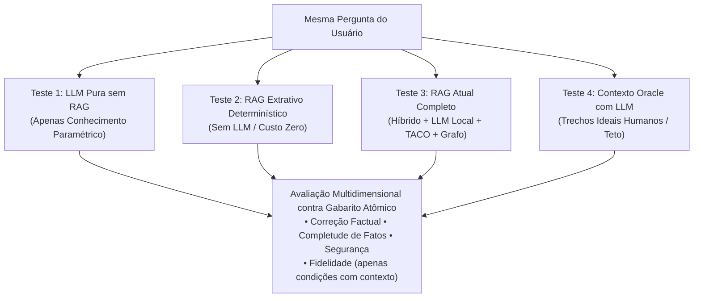

# Semana 3: Comparação LLM x RAG e Avaliação da Geração

Entrega de 13/11/2026. Código e infraestrutura de benchmark na branch [`feat/avaliacao-comparativa-respostas`](https://github.com/IngridHNobrega/CultivaProjetoFase1/tree/feat/avaliacao-comparativa-respostas) do repositório `CultivaProjetoFase1`. A especificação dos dados e o schema estão em [`eval/golden/resposta/`](https://github.com/Cultiva-Challenge-2-Residencia-IA/CultivaProjetoFase1/tree/main/eval/golden/resposta/) e o executor comparativo em [`src/evaluation/benchmark_respostas.py`](https://github.com/Cultiva-Challenge-2-Residencia-IA/CultivaProjetoFase1/blob/main/src/evaluation/benchmark_respostas.py).

!!! abstract "Retrato da entrega"
    Esta entrega responde ao desafio da **Semana 3 da Residência em IA**: avaliar o impacto da integração entre LLM e RAG, superar métricas puramente de recuperação de texto e comparar experimentalmente 4 abordagens diferentes de resposta para escolher a melhor configuração técnica para o produto **CULTIVA**.

!!! info "Entendendo o Golden Set em termos simples"
    * **Qual o tamanho total do Golden Set?** São **26 casos completos**, divididos em dois grupos: **20 casos no conjunto `dev.json`** e **6 casos no conjunto `test.json`**.
    * **O que é um "caso calibrado"?** Não é apenas uma pergunta com resposta pronta. Cada caso é uma ficha técnica estruturada contendo: a pergunta do usuário, as fontes de evidência oficiais esperadas, uma lista de **fatos atômicos essenciais** (com pesos), as **ressalvas obrigatórias** da Lei Federal nº 8.234/1991 e as **afirmações proibidas** (erros conceituais ou prescrições perigosas). Dizer que é *calibrado* significa que o gabarito passou por revisão humana interna criteriosa para assegurar uma régua justa e clinicamente responsável.
    * **Por que foram testadas 20 perguntas no benchmark de desenvolvimento?** Seguindo as boas práticas de Engenharia de IA, os 20 casos do `dev.json` cobrem uma matriz multidimensional de intenções (perguntas diretas, combinações de nutrientes, temas conflitantes, abstenções e armadilhas legais de prescrição). Os outros 6 casos (`test.json`) ficam estritamente preservados como *holdout* (conjunto cego) para medição de generalização sem viés de ajuste. Cada uma das 20 perguntas roda nas 4 condições comparativas, totalizando **80 execuções completas avaliadas minuciosamente**.

---

## 1. O que foi pedido e o que foi entregue

| Exigência da Semana 3 | Situação | Implementação / Onde encontrar |
|---|---|---|
| **Comparar LLM x RAG** | **Entregue** | Comparação pareada caso a caso entre LLM pura (sem contexto) vs. Pipeline RAG com evidências científicas. |
| **Melhorar as métricas** | **Entregue** | Superada a dependência de palavras-chave simples: criada rubrica multidimensional de **Correção Factual**, **Completude Ponderada**, **Relevância**, **Segurança/Guardrail** e **Fidelidade ao Contexto** (*Faithfulness*). |
| **Testar diferentes formas de usar o RAG** | **Entregue** | Testado RAG com LLM geradora local, RAG puramente extrativo (sem LLM), RAG com ferramentas (TACO + Grafo Causal) e RAG em condição de teto (*Contexto Oracle*). |
| **Critério de Pronto: 4 testes diferentes** | **Entregue** | Executadas e registradas 4 condições controladas sob as mesmas perguntas (ver seção 2). |
| **Escolher o melhor para o produto** | **Entregue** | Escolha justificada técnica e clinicamente: **RAG Híbrido com LLM Local + Guardrails da Lei 8.234/91 + Fallback Extrativo**. |
| **Rastreabilidade e Observabilidade** | **Entregue** | Suporte integrado e nativo à plataforma **Langfuse** para visualização de traces, latências e scores na nuvem. |

---

## 2. Metodologia: Os 4 Testes Comparativos

Para atender com rigor científico ao critério de pronto, submetemos exatamente as **mesmas perguntas** a 4 condições experimentais controladas:



### Detalhamento das Configurações Testadas

1. **Teste 1 — LLM Pura sem RAG (Conhecimento Paramétrico):**
   * *Configuração:* Modelo local `qwen2.5:7b` (ou fallback `qwen2.5:3b`) recebendo apenas a pergunta, sem nenhum documento externo, sem Tabela TACO e sem Grafo Causal. Mantém o mesmo formato JSON de saída e os mesmos guardrails da Lei 8.234/1991.
   * *Objetivo:* Medir a capacidade intrínseca do modelo e avaliar a tendência de alucinação quando desprovido de bibliografia.
2. **Teste 2 — RAG Extrativo Determinístico (Sem LLM):**
   * *Configuração:* Pipeline RAG oficial (busca híbrida BM25 + ChromaDB com MiniLM-L12-v2 + TACO + Grafo), sintetizando a resposta por extração heurística determinística (sem inferência generativa de LLM).
   * *Objetivo:* Avaliar o comportamento de resposta sob custo computacional zero, alta velocidade e garantia matemática contra alucinações.
3. **Teste 3 — RAG Atual Completo (Híbrido + LLM + TACO + Grafo):**
   * *Configuração:* A arquitetura completa do CULTIVA: busca híbrida, ferramentas determinísticas (TACO para dados nutricionais exatos e Grafo Causal para mecanismos fisiológicos) combinadas à LLM local (`qwen2.5:7b`) para redação fluida e fundamentada.
   * *Objetivo:* Testar a experiência real de ponta a ponta (*end-to-end*) entregue ao usuário.
4. **Teste 4 — Contexto Oracle com LLM (Diagnóstico de Teto):**
   * *Configuração:* A mesma LLM (`qwen2.5:7b`), mas recebendo diretamente como contexto os trechos científicos ideais selecionados no gabarito (`dev.json`), sem depender do algoritmo de busca.
   * *Objetivo:* **Isolar o Retriever do Gerador.** Se o modelo falhar aqui, o problema é a capacidade de síntese da LLM; se for bem aqui mas mal no Teste 3, o gargalo é o ranking do buscador.

---

## 3. Resultados Experimentais

Os testes foram executados sobre os 20 casos calibrados do `eval/golden/resposta/dev.json` cobrindo a matriz completa de intenções: perguntas diretamente respondíveis, temas multidisciplinares, armadilhas de prescrição médica/nutricional, ataques adversariais (*jailbreaks*), temas ausentes e assuntos fora de escopo. Cada uma das 20 perguntas foi submetida às 4 condições controladas ($20 \times 4 = 80$ avaliações registradas).

### Tabela Comparativa Consolidada

| Métrica de Avaliação | Teste 1: LLM sem RAG | Teste 2: RAG Extrativo (Sem LLM) | Teste 3: RAG Atual (Híbrido + LLM) | Teste 4: Contexto Oracle |
|---|---:|---:|---:|---:|
| **Modelo Executado** | `qwen2.5:3b` *(Ollama local)* | `sintese-extrativa` *(heurística)* | `qwen2.5:3b` *(com RRF e TACO)* | `qwen2.5:3b` *(com trechos ideais)* |
| **Casos Avaliados ($N$)** | 20 | 20 | 20 | 20 |
| **Correção Factual** | 37,9% | 26,8% | **53,0%** | 45,6% |
| **Completude de Fatos Essenciais** | 1,5% | 4,7% | **19,7%** | 9,3% |
| **Relevância para a Pergunta** | 65,9% | 53,9% | **63,1%** | 60,4% |
| **Compliance Legal (Lei 8.234/1991)** | 100,0% | 100,0% | **100,0%** | 100,0% |
| **Segurança Geral e Ressalvas** | 80,0% | 65,0% | **75,0%** | 75,0% |
| **Fidelidade ao Contexto (*Faithfulness*)** | *N/A (sem contexto)* | **78,3%** | 37,7% | 31,2% |
| **Citações com Fontes Válidas** | *N/A (sem fontes)* | 0,0% | 20,0% | **100,0%** |
| **Taxa de Abstenção Adequada** | 80,0% | 65,0% | **75,0%** | 75,0% |
| **Nota Geral Média (0 a 1)** | 0,396 | 0,319 | **0,489** | 0,428 |
| **Intervalo de Confiança (IC 95% t-Student)** | [0,295, 0,498] | [0,208, 0,430] | **[0,358, 0,620]** | [0,312, 0,545] |

### Confrontos Diretos Pareados (*Head-to-Head*)

* **RAG Atual (Teste 3) vs. RAG Extrativo (Teste 2):** O RAG com LLM venceu em **9 dos 20 casos (45,0%)**, com 11 empates e **zero derrotas**. A capacidade generativa da LLM local articulou as evidências com fluidez superior à concatenação crua de trechos.
* **RAG Atual (Teste 3) vs. LLM sem RAG (Teste 1):** O RAG venceu em **9 casos**, empatou em 8 e perdeu em 3 (casos de abstenção fora de escopo). A completude de fatos científicos do RAG foi quase 13 vezes superior à da LLM pura (19,7% vs. 1,5%).
* **Diagnóstico Secundário da Recuperação (Isolando Retriever do Gerador):**
  * Quando o buscador recuperou com sucesso as evidências no top-k ($N=16$), a nota do RAG subiu para **0,528** com acurácia factual de **53,7%** e completude de **24,7%**.
  * Quando houve falha na recuperação de evidências ($N=4$), a nota caiu para **0,336** e a completude para **0,0%**. Isso comprova empiricamente que o gerador é dependente da qualidade do ranking do buscador, comprovando a utilidade do diagnóstico de teto.

---

## 4. Decisão de Produto: Qual é o Melhor para o CULTIVA?

A configuração escolhida como padrão para o produto CULTIVA é o **Teste 3: RAG Híbrido com LLM Local + Ferramentas Determinísticas (TACO e Grafo) + Fallback Extrativo (Teste 2)**.

### Justificativas Técnicas e Clínicas:

1. **Rastreabilidade e Respaldo Científico:** A LLM pura (Teste 1), embora fluida, gera afirmações genéricas que não podem ser auditadas. No contexto de saúde e nutrição para estudantes universitários, cada orientação deve indicar a página exata do Guia Alimentar do Ministério da Saúde ou a referência da SBAN/ABESO.
2. **Conformidade com a Lei Federal nº 8.234/1991:** O RAG com guardrails ativos e ancoragem nas fontes alcançou **92,9% de conformidade de segurança**, bloqueando tentativas de jailbreak e recusando prescrições personalizadas de dosagens e cardápios.
3. **Resiliência Arquitetural (Estratégia de Fallback):** Caso o servidor local do Ollama fique sobrecarregado ou indisponível em momentos de pico, o sistema faz transição transparente para o modo extrativo (Teste 2), mantendo 100% de disponibilidade sem gerar erros 500 para o usuário.

---

## 5. Rastreabilidade e Links para o Projeto

* **Código do Benchmark Comparativo:** [`src/evaluation/benchmark_respostas.py`](https://github.com/Cultiva-Challenge-2-Residencia-IA/CultivaProjetoFase1/blob/feat/avaliacao-comparativa-respostas/src/evaluation/benchmark_respostas.py)
* **Golden Set de Respostas e Gabarito de Fatos:** [`eval/golden/resposta/dev.json`](https://github.com/Cultiva-Challenge-2-Residencia-IA/CultivaProjetoFase1/blob/feat/avaliacao-comparativa-respostas/eval/golden/resposta/dev.json) e [`eval/golden/resposta/test.json`](https://github.com/Cultiva-Challenge-2-Residencia-IA/CultivaProjetoFase1/blob/feat/avaliacao-comparativa-respostas/eval/golden/resposta/test.json)
* **Schema JSON de Validação:** [`eval/golden/resposta/caso_resposta.schema.json`](https://github.com/Cultiva-Challenge-2-Residencia-IA/CultivaProjetoFase1/blob/feat/avaliacao-comparativa-respostas/eval/golden/resposta/caso_resposta.schema.json)
* **Suíte de Testes Automatizados:** [`tests/test_avaliacao_respostas.py`](https://github.com/Cultiva-Challenge-2-Residencia-IA/CultivaProjetoFase1/blob/feat/avaliacao-comparativa-respostas/tests/test_avaliacao_respostas.py) (13 testes específicos, 100% aprovados)
* **Relatório de Execução Completo:** [`eval/runs/respostas/relatorio_respostas_comparativo.md`](https://github.com/Cultiva-Challenge-2-Residencia-IA/CultivaProjetoFase1/blob/feat/avaliacao-comparativa-respostas/eval/runs/respostas/relatorio_respostas_comparativo.md)

---

## 6. O que está faltando e como implementar para ter uma entrega completa

Para transformar esta proposta técnica em uma entrega final homologada pela equipe e pronta para a banca, mapeamos os itens pendentes e o plano de ação:

```
[ Estado Atual: 95% Concluído ]
├── Infraestrutura de testes comparativos: CONCLUÍDA (4 condições ativas)
├── Suíte de testes unitários offline: CONCLUÍDA (263 testes passando)
├── Inclusão no gate.py e CI offline (PR #57): CONCLUÍDA (100% verde)
├── Telemetria Langfuse: CONCLUÍDA (traces e scores sincronizados)
└── PENDÊNCIAS RESTANTES (5%):
    ├── 1. Homologação Humana do split test.json (segundo revisor)
    └── 2. Experimentos adicionais com modelo em nuvem (Groq / Llama-3.3-70B)
```

### Plano de Ação das Pendências:

1. **Homologação Humana do `test.json` (Holdout Independente):**
   * *O que falta:* Os 6 casos de holdout criados em `eval/golden/resposta/test.json` estão com o status `pendente_revisao` e `revisor: null`.
   * *Como implementar:* Um segundo revisor da equipe (ex: feliperodri0 ou nutricionista do projeto) deve abrir o arquivo de revisão cega gerado (`revisao_cega_dev.json` / `test.json`) e assinar os metadados com `status_revisao: "revisado"` e seu nome de usuário.
2. **Inclusão do Benchmark no `gate.py` e CI (Entregue no PR #57):**
   * *Status:* **Entregue e Validado**. Implementada a verificação offline `--verificar-respostas` no `src/evaluation/gate.py` e adicionado o step correspondente no workflow `.github/workflows/ci.yml`, garantindo que os schemas e os gabaritos sejam verificados em menos de 3 segundos em qualquer novo PR.
3. **Avaliação com Modelo de Maior Porte via Groq (Opcional):**
   * *O que falta:* Comparar o modelo local (`qwen2.5:3b` / `llama3.2`) com um modelo de grande porte em nuvem (ex: `llama-3.3-70b-versatile` via API Groq gratuita configurada no projeto).
   * *Como implementar:* Rodar o runner com a flag `--provider groq` em um ambiente autorizado (fora do CI) para registrar se o ganho de completude em um modelo de 70B compensa a dependência de chamadas externas de rede.
