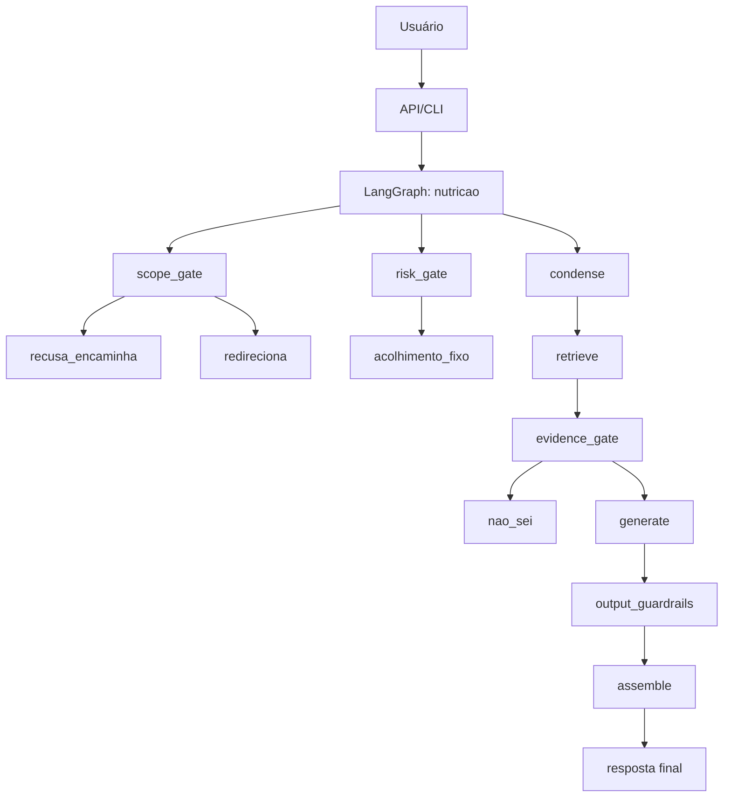

# Plano da frente de nutrição

## 1. Visão arquitetural

A arquitetura do CULTIVA segue uma composição em camadas: ingestão, recuperação, geração e guardrails, com um grafo principal em LangGraph.

## 2. Stack recomendado

- Python 3.11+
- LangGraph
- FastAPI + Pydantic v2
- Postgres + pgvector via Docker
- `VectorStore` com `PgVectorStore` e fallback `InMemoryStore`
- `Embedder` e `LLMClient`
- `JsonlTracer` local
- pytest + pytest-bdd + ruff

## 3. Decisões de arquitetura

- A recuperação (M1) é prioritária antes da geração. Isso reduz falso positivo de prompt e melhora groundedness.
- O trace local em JSONL substitui Langfuse no slice 1 e atende RNF08 sem elevar a complexidade do ambiente.
- O fallback para `InMemoryStore` mantém testes e dev funcionando sem Docker.
- O grafo centraliza risco e escopo antes da geração para manter segurança e baixa latência.

## 4. Fluxo de execução

1. Guarda entrada, mascara PII e gera `thread_id`.
2. Aplica `risk_gate` e `scope_gate` antes do uso de LLM.
3. Se houver histórico, aplica `condense`.
4. Busca híbrida densa + lexical.
5. Gate de evidência para verificar a qualidade do melhor trecho.
6. Gera resposta estruturada com fontes.
7. Aplica validação de schema e guardrails de saída.
8. Cria trace com prompt/modelo/corpus versionado e resposta final.

## 5. ADRs previstos

- ADR-0001: busca híbrida antes de geração
- ADR-0002: `JsonlTracer` local como rastreio obrigatório
- ADR-0003: `InMemoryStore` como fallback de teste
- ADR-0004: `LangGraph` como orquestrador do fluxo principal

## 6. Riscos e mitigação

- Risco de enxerto de conteúdo fora do corpus: usar whitelist + grounded check.
- Risco de prompt injection: módulo de input guard e isolamento de trechos.
- Risco operacional: fallback com `InMemoryStore` e `FakeLLM` para CI.
- Risco de latência: gate de evidência e benchmark M1/M2.
