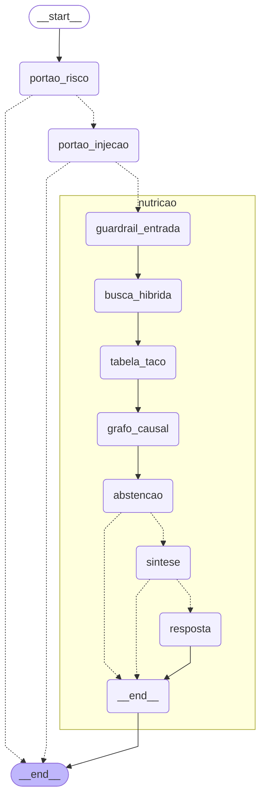

# Orquestrador (LangGraph)

Grafo que recebe a pergunta, passa pelos portões de segurança e entrega ao agente (issue #76). Hoje há um só agente, o de Nutrição. O roteamento entre agentes e o Agente de Saúde Física ficam para issues próprias.

- `grafo.py`: grafo principal. Os portões de risco (RF-IA03) e de prompt injection (RNF04) são os primeiros nós e ficam **fora** dos agentes, para valerem para todos. Uma pergunta barrada termina com resposta fixa, sem chegar a agente nenhum.
- `src/agents/nutricao/grafo.py`: subgrafo de Nutrição, com a mesma sequência de antes. As saídas antecipadas ("não sei" por falta de domínio ou por `llm_sem_base`) são arestas condicionais para o fim.
- `NutritionConsultantBaseline.consult()` monta o grafo na primeira chamada e o invoca, com a mesma assinatura e a mesma `ConsultantResponse` de antes. A API, os benchmarks e a demonstração não mudam.

**Contrato de um agente:** subgrafo compilado cujo estado tem `pergunta`, `top_k` e `resposta`. Ele lê os dois primeiros e escreve o terceiro. O que mais ele usar fica no estado interno dele e não vaza para o grafo principal nem para outros agentes (RF-IA09).

**Para acrescentar um agente:** crie `src/agents/<agente>/grafo.py` com `construir_subgrafo(...)` e passe-o em `agentes` de `construir_grafo`. O nó de roteamento que escolhe entre eles ainda não existe: enquanto houver um só agente, a pergunta vai para o `agente_padrao`.

## Diagrama

Gerado com `uv run python -m src.orquestrador`. Linhas tracejadas são arestas condicionais.

